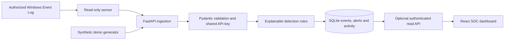

# Architecture overview

SentinelForge is an educational defensive monitoring project. The React/Vite dashboard is a static client; FastAPI owns ingestion, detection orchestration and persistence; SQLite stores event and alert records. The Windows sensor is an optional event forwarder.

## Trust boundaries

- Browser to API: public HTTPS transport; never embed the ingestion key in frontend code.
- Sensor/loader to API: trusted machine credential in `X-API-Key`.
- API to database: backend-only filesystem access; use persistent storage.
- CI to repository: least-privilege workflow token and reviewed dependency changes.

## Current limitations

Read endpoints are unauthenticated. Do not expose real telemetry to the public internet until an authentication and authorization gateway is in place.

## Data flow (Mermaid)

GitHub Pages serves only the static dashboard; the API and SQLite database require a separate private backend. A shared API key is not individual analyst authentication.
